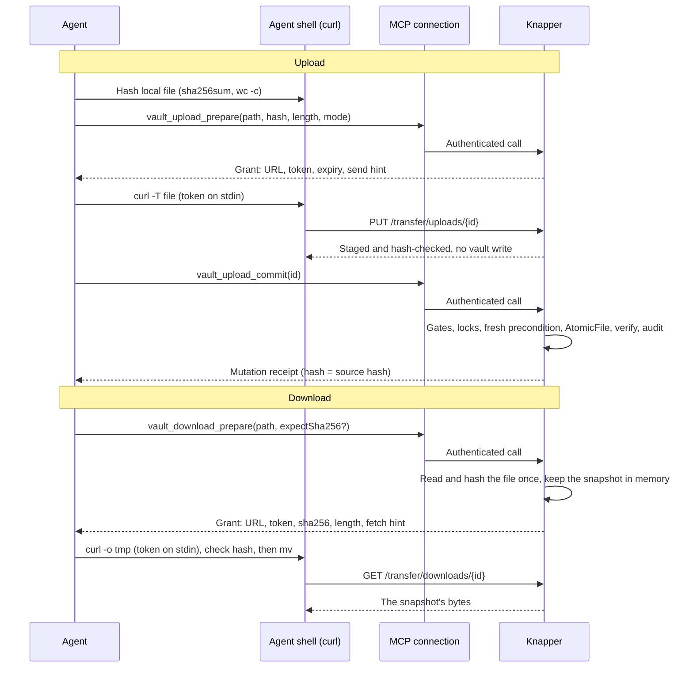

# Proposal: transfer grants — moving files between agents and the vault

**Status: download direction BUILT and DEPLOYED (v0.13.0, 2026-11-08);
upload direction BUILT 2026-11-08 on branch `transfer-grants-upload`
(unreleased; off by default). Reviewed 2026-11-08; the review's findings are folded
in below.** Consolidated 2026-11-07 from the upload-grants proposal of
2026-09-05 and its three amendments. Everything below is current; nothing
here is superseded by a later section. The earlier versions are in this
file's git history (it was `upload-grants.md` until 2026-11-07). For what
Knapper does today, read [architecture.md](../architecture.md) and
[usage.md](../usage.md).

The 2026-11-08 review changed five things: commit now scans text payloads for
secrets BEFORE the write (§4.3); download prepare guards against a torn read
(§5.1); open decision 1 is closed by the brief (§16); `vault_download_prepare`
is marked as a writer (§13); and §9 says plainly which layer protects the MCP
route when the edge Bypass misbehaves.

A second pass the same day, checked against the code, changed four more.
The pre-landing secret scan now covers exactly what `GitCommitJob` scans
(§4.3). The earlier "strict UTF-8 only" rule let a Latin-1 `.env` or a
stored zip land and then wedge every commit, and the §15 test that read
"binary … not scanned and lands" asserted that wedge. A read-only
deployment refuses `Download:Enabled` as well as `Upload:Enabled` (§13).
The rate limiter runs after authentication, never in front of a valid token
(§11, decision 5). The separate-hostname choice became decision 6,
with the Host binding it needs (§9).

Gate zero's path-handling question was then answered on the production
edge itself, with no disposable deployment (§9, §15). An existing
path-scoped child application served as the stand-in for the planned
Bypass, and unauthenticated probes showed which application matched each
request. What is left is measured on the first deployment.

Later on 2026-11-08 the owner closed every remaining decision (§16):
download first, all four tool names registered in the first release, the
download allowlist, the rate limiter after authentication, no client
helper, and both routes under one `/transfer` prefix on the existing vault
hostname (§9).

Reviewers: §16 records every decision and what it rejected, and §17 lists
the places this document most needs a skeptical read.

## 1. The problem

Knapper's tools move text. Two kinds of file work fall outside that.

**Getting a file IN when the agent does not hold the vault's current
bytes.** Knapper has no upload-from-path. Content that is not already in the
vault enters only through model output tokens. That costs output tokens in
proportion to the file. Chunked appends make it quadratic in chunk count.
And the receipt proves only sent→disk, never source→sent: a transcribed CSV
can lose rows and still earn a perfect `Verified: true`
([bulk-ingest.md](bulk-ingest.md) has the full analysis). Binary content
cannot enter at all. Once built, this design replaces bulk-ingest.md's
"build nothing yet" recommendation for files already on an agent's disk.

**Getting a file OUT onto the agent's disk.** `vault_read` refuses anything
that is not UTF-8 (`NotUtf8`), and no tool hands bytes over. An agent
building something printable from photos and PDFs the vault holds cannot get
them. Measured 2026-11-07 via `vault_files`, the deployment this was written
for held 17 binaries outside its archive: mostly phone photos of a few MB
and a PDF, and among them images of a kind text scanning cannot judge
(photos of people; an image can encode a credential `SecretScanner`
cannot read).

Two things that look like answers are not:

- **Bytes through the model.** A 2.9 MB photo is about 3.9 million base64
  characters, roughly fifty times Claude Code's default MCP result cap. The
  agent would then have to type the bytes back out to write a file, which is
  the transcription problem above, in the other direction.
- **MCP image content blocks.** They let a model *see* a photo, but they
  produce no file and do nothing for PDFs. They may be worth adding later for
  viewing; they do not answer this.

## 2. When a transfer is the right tool

**Upload: the discriminator is the BASE, not the size.** When the agent
holds the destination's current bytes, an anchored `vault_edit` sends only
the changed regions, keeps the SHA precondition and the guards, and returns
a receipt that proves the result by hash. That is cheaper than an upload at
every size where the diff is small relative to the file.

Evidence (2026-09-05): a 20 KB deployment script stored in the vault was
updated to 27 KB through seven anchored hunks, about 7 KB of edit text against
the ~47 KB a whole-file round trip would have cost. The returned hash matched
the local file exactly. Upload is right when, and only when, one of these
holds:

- the file is new (no base exists);
- the payload is not UTF-8 text;
- the change is a wholesale rewrite, so the diff approaches the file;
- the caller does not hold the current bytes (another machine, another
  agent, or a file only the vault has).

No instruction may state this as a size threshold. "Use uploads for large
files" routes evolving text onto the path that costs more, gives up anchored
guards, and burns a grant.

**Download: any time the agent needs the file itself on disk.** Binaries are
the obvious case. Text counts too: downloading a script byte-exact gives the
agent the base locally, so its next change can be a cheap anchored
`vault_edit`.

## 3. Design

An authenticated MCP call authorizes each transfer. Plain HTTPS moves the
bytes. For uploads, a second authenticated MCP call commits them. Between
the MCP calls, the agent holds a **grant**: a single-use, short-lived
capability bound to exact bytes.



Properties the design exists to hold:

- **No second credential.** The transfer inherits whatever authentication
  the agent's MCP connection already has. It needs no Cloudflare service
  token, OAuth refresh token, SSH key, Knapper client binary, or direct vault
  access.
- **Portable by design.** Every step is completable from any agent harness
  with a POSIX shell and network reach to the server, using `curl` and a
  SHA-256 tool and nothing else (§6).
- **The public routes cannot write the vault.** A PUT only stages bytes. The
  vault write happens at commit, through the authenticated MCP surface and
  the ordinary mutation path. Committing inside the PUT would save a round
  trip, but it would give a bearer token vault-write authority and make a
  public endpoint handle mutations, attribution and ambiguous write retries.
- **The public GET cannot read the vault.** It serves only a snapshot
  captured at prepare. It opens no file, resolves no path, and calls no Core
  read. A defect in download authentication can leak at most the snapshots
  of currently live grants, never an arbitrary path. A read-through design
  that resolved the path at GET time would turn the same defect into
  unauthenticated read access to the whole vault. Serving the snapshot also
  means the bytes sent are exactly the bytes hashed.
- **Fidelity end to end.** An upload's commit receipt must report the source
  hash bound into the grant, so the proof runs from the agent's file to the
  verified vault bytes. A download's hash arrives over the authenticated MCP
  channel, and the client checks the received bytes against it before using
  them.

## 4. Upload protocol

Three MCP tools and one HTTP route. Every tool takes 1–16 items, because a
single-file prepare would make six photos cost twelve MCP round trips plus
six transfers. Results are per item, as in `vault_batch_read`: each item is
its own grant, receipt or typed error, and one bad item never hides the
rest. Everything said below about one grant holds per item.

### 4.1 Prepare

```text
vault_upload_prepare(items: [{
    path, sourceSha256, byteLength,
    mode: "create" | "replace",
    expectSha256?
}])
```

- **`create` means the destination must be absent.** A supplied
  `expectSha256` is refused.
- **`replace` requires a nonempty `expectSha256`** and refuses a missing
  file. It is available only when `Upload:AllowReplace` is true; otherwise it
  fails `UploadReplacementDisabled` (the default is decision 1). Never
  infer an upsert, fall back to create, or fetch a newer hash automatically.
- **Duplicate destination paths in one call are refused**, as in
  `vault_batch`.
- **Each path goes through `VaultPathResolver`.** The source hash and byte
  count are validated, and capacity is reserved per item. An item that does
  not fit fails `UploadCapacityExceeded` and the agent sends it in a later
  round. Parent directories must already exist.
- **Early checks are advisory.** Destination state, archive status and the
  gates are checked again at commit; prepare neither reserves the path nor
  replaces those checks.

The server records, per grant: a random upload ID; the hash of a separately
generated 256-bit token; the verified issuing principal (§8), request ID and
attribution; the destination, mode and original precondition; the exact
source length and SHA-256; an expiry; and the state. Prepare durably audits
the grant before returning it, and rolls back the reservation if that append
fails.

It returns the upload URL, built from configured `Transfer:PublicOrigin`
and never from Host or forwarded headers, plus the ID, token, expiry, an
echo of the bound metadata, and a fixed-text `send` hint (§6). The echo is
information for the agent, not a safeguard: the server binds length and
hash, so a wrong source fails at transfer, and no instruction may present
the echo as a check.

### 4.2 Transfer

```text
PUT /transfer/uploads/{uploadId}
Authorization: KnapperUpload <token>
Content-Type: application/octet-stream

<raw file bytes>
```

- **Authenticate before buffering.** The server checks the token and
  receiver capacity, then atomically claims the grant, reads a bounded body,
  and compares its actual length and SHA-256 with the grant. The URL ID is
  not a credential. The request cannot change the destination or the
  precondition.
- **The payload is opaque.** No UTF-8 conversion, BOM removal, newline
  change, base64, decompression, archive extraction, execution, or
  MIME-driven processing. Only `application/octet-stream` and absent or
  identity `Content-Encoding` are accepted.
- **Length is enforced on the stream.** `Content-Length` is optional, but
  when present it must equal the bound length. Excess bytes and truncated
  bodies are refused; a matching prefix of a longer body is never staged. A
  complete zero-byte body is valid. `Expect: 100-continue`, which curl sends
  for larger bodies, must work end to end.
- **Success means `staged` only.** The 200 response carries
  `{uploadId, state: "ready", byteLength, sha256}`. It never uses the
  mutation receipt's `Verified` wording and never claims Sync delivery.
  There is no list endpoint and no file content in any error response.

### 4.3 Commit

```text
vault_upload_commit(uploadIds: [string])
```

- **Same principal, ready grant.** Commit requires owner authentication and
  the principal that prepared the grant; the ID alone is not enough. It
  atomically claims a ready, unexpired grant and takes no alternative path,
  bytes or hash.
- **Items commit one after another, in sorted path order, as independent
  mutations.** This is not atomic across files, any more than `vault_batch`'s
  apply phase is. A failure does not stop later items. Commit must NOT go
  through `vault_batch`'s validate-everything-first step: each upload carries
  its own precondition, and refusing fifteen valid files because one is
  stale would make a batch of photos fail on one rename.
- **Each item runs the ordinary mutation discipline** through a
  byte-oriented entry point in `VaultMutationService` (§12): resolve the
  destination again, conflict and sync gates, locks, fresh read and hash
  check, archive check, Sync size guard, write-ahead audit, `AtomicFile`,
  containment checks on both sides, byte verification. No network read
  happens while vault locks are held. An existing file keeps its mode; a new
  one gets the normal create mode.
- **A text payload is scanned for secrets BEFORE it lands.** `SecretScanner`
  refuses the vault's git commit when any staged file holds a
  credential-shaped string, and `GitCommitJob` retries every tick, so one
  such file stops the WHOLE vault reaching history until a human edits it.
  Today that takes an agent typing a secret into `vault_create`; an upload
  makes it a one-liner (a 2 MB log, a `.env`, a shell history). So commit
  runs the scanner over the payload inside the audited region and before any
  temp file exists, and refuses the item `SecretDetected` with the finding
  MASKED exactly as the committer masks it. The grant goes terminal; the
  bytes never reach the vault.
- **The pre-landing scan covers EXACTLY what the committer will scan, no
  more and no less.** The committer does not scan by content type.
  `GitCommitJob.ScanStaged` decodes EVERY staged blob of at most
  `MaxScanBlobBytes` (4,000,000) as UTF-8, binary included, plus any size of
  blob whose extension is in `AlwaysScannedExtensions`. A pre-landing rule
  narrower than that ("strict UTF-8 text only", as an earlier draft said)
  admits exactly the files that then wedge the committer: a Latin-1 `.env`
  is not strict UTF-8, and a stored (uncompressed) zip holding a key is
  binary, yet both decode to a match at commit. So the selection rule and
  the decode become ONE shared definition in `Knapper.Core.Git`, used by
  both callers. The committer reads the blob as bytes and calls the same
  decoder rather than relying on its process stdout reader, so the two cannot
  disagree about BOMs or invalid sequences. **Built 2026-11-08** as `SecretScanPolicy`
  (`ShouldScan`, `Decode`, `Scan`). Building it found a blind spot the
  committer already had: a byte-order mark is two bytes, so a file that
  merely started `FF FE` was decoded wholesale as UTF-16 and hid every
  credential in it. A non-UTF-8 mark now gets both readings scanned. Review
  of the build found the other half of parity: `git add` itself re-encodes
  a path carrying `working-tree-encoding`, so a UTF-16 credential the
  pre-scan cannot see appears in the staged blob. The committer refuses any
  staged path with that attribute, as it refuses a filter driver. A payload neither scans is
  over 4,000,000 bytes with a non-text extension, which is the committer's
  standing attachment limit, not a new gap. A binary that matches by
  accident is refused here rather than wedging every commit later, which is
  strictly the better failure. The pre-existing path (`vault_create` with a
  secret in the text) has the same consequence and is out of scope here;
  whether the text tools should get the same pre-landing scan is a question
  for `docs/extending.md`'s open decisions, not this proposal.
- **The receipt is the ordinary mutation receipt plus the upload ID.** Its
  new hash must equal the source hash bound into the grant. That proves
  transfer fidelity, not that the content is correct.

### 4.4 Status

```text
vault_upload_status(uploadIds: [string])
```

Same owner and principal checks. It returns each grant's state and, once
terminal, its stored outcome, and never a token or bytes. It is separate
from commit so that checking an uncertain transfer cannot start a vault
mutation. There is no cancel tool; expiry reclaims abandoned grants.

## 5. Download protocol

One MCP tool and one HTTP route. Nothing needs committing, and an uncertain
transfer is settled by the client's own hash check, so there is no commit or
status tool.

### 5.1 Prepare

```text
vault_download_prepare(items: [{ path, expectSha256? }])   // 1..16
```

- **Per-item results**, as for upload.
- **Each path goes through `VaultPathResolver`**, which refuses hidden and
  control paths and symlink components. The file is opened with
  `Posix.OpenRegularForRead`, so a FIFO or symlink swapped in cannot hang
  the call or be followed. The whole file is read once into memory, bounded
  by `Sync__MaxFileBytes` (over it: `TooLarge`), and hashed. That snapshot is
  what the GET will serve.
- **The read is guarded against a torn snapshot.** It takes no lock, and
  the locks bind only Knapper writers anyway: Sync and a human shell can
  write in place while the read is in flight, and a read that straddles such
  a write returns bytes from two versions. Its hash is the hash of THAT
  snapshot, so the client's check passes and the agent holds a file that
  never existed on disk. **As built, the guard is by CONTENT**: prepare reads
  the whole file TWICE through the same descriptor and serves the snapshot
  only when both reads agree byte for byte and the descriptor's size and
  mtime did not move across them; otherwise it re-reads, up to four
  attempts, and fails `IoError` if the file will not settle. (The design
  first proposed comparing size, mtime and ctime; the stat helper carries no
  ctime, and a second read is the stronger proof anyway, in the codebase's
  own currency.) The stat comparison only ever drives a RETRY, never a
  decision to serve (CLAUDE.md's `Replace` rule). The residual is a writer
  that stalls identically across both reads, and the grant's hash describes
  what the agent received, not that the file was ever quiescent in that
  state. At the 5 MiB ceiling the second read costs milliseconds.
- **`expectSha256` is optional.** When supplied, a mismatch fails the item
  `PreconditionFailed` and issues nothing. When absent, the grant reports the
  snapshot's hash, which arrived over the authenticated channel and is
  enough to verify against. Making it mandatory would add a `vault_stat`
  round trip per file and buy no integrity.
- **Any regular file type may be downloaded**, text included. Archived
  subtrees are readable, so they are downloadable. The conflict and sync
  gates guard mutations only and do not apply.
- **Scope.** Items outside `Download:AllowedPrefixes` fail
  `DownloadNotPermitted` (decision 2).
- **Capacity.** An item that does not fit the buffer budget fails
  `DownloadCapacityExceeded`.

Prepare durably audits each grant before returning it: path, size, hash,
principal, client and request ID. This makes it the first audited read in
Knapper, and it must be one, because a download carries vault bytes past the
host boundary into a workspace where outbound tools can reach them.

Each grant returns `downloadId, downloadUrl, downloadToken, expiresAt, path,
sha256, byteLength` and a fixed-text `fetch` hint (§6).

### 5.2 Transfer

```text
GET /transfer/downloads/{downloadId}
Authorization: KnapperDownload <token>
```

- **The response is the snapshot**: 200, `application/octet-stream`, exact
  `Content-Length`, `Cache-Control: no-store`,
  `X-Content-Type-Options: nosniff`, and `Content-Disposition: attachment`
  with no filename. The vault path never appears in a URL or header, so it
  never reaches edge logs.
- **`Range` is ignored: the response is always 200 with the full body.** A
  206 would fail the client's hash check with a misleading error. The same
  goes for conditional headers (`If-None-Match`, `If-Modified-Since`): no
  304, no `ETag`, no `Last-Modified`.
- **The first admitted GET claims and burns the grant**, and the snapshot is
  freed once it has been served. A dropped connection, a partial body or a
  failed local hash means prepare again; preparing is a cheap idempotent
  read.
- **HEAD and every other method get 405** and claim nothing.

## 6. The client: plain curl, tested as written

**The supported client is `curl` ≥ 7.76 plus `sha256sum`** (or `shasum -a 256`
where `sha256sum` is missing), run from the agent's shell. 7.76 is needed
for `-H @-` and `--fail-with-body`. No Knapper binary on the client, and no
harness-specific step. Windows clients are out of scope; the server is
Unix-only and the recipes assume a POSIX shell.

**The recipes are part of the contract.** The acceptance suite runs them
literally, with real `bash`, `curl` and `sha256sum`, against a real server
process. A recipe that only works with a newer curl, a particular harness,
or a step the instructions omit fails that test. That test is what keeps
"portable" true rather than merely claimed. A harness that needs a different
recipe is a defect in the recipe, never a reason to fork it.

Upload (hash, then prepare with `sha` and `len`, then send):

```sh
sha=$(sha256sum < "$SRC" | cut -d' ' -f1); len=$(wc -c < "$SRC" | tr -d ' ')
printf 'Authorization: KnapperUpload %s\n' "$TOKEN" |
  curl --fail-with-body -sS --proto '=https' --max-redirs 0 --max-time 60 \
       -T "$SRC" -H 'Content-Type: application/octet-stream' -H @- "$URL"
```

Download (after prepare). **As built, this text IS the grant's `fetch`
field**, prefixed by three shell-comment lines that say which variables to
set, so the whole field runs as written:

```sh
( umask 077; tmp=$(mktemp "$(dirname "$DEST")/.knapper-dl.XXXXXX") &&
  printf 'Authorization: KnapperDownload %s\n' "$TOKEN" |
  curl --fail -sS --proto '=https' --max-redirs 0 --max-time 120 \
       --max-filesize "$LEN" -H @- -o "$tmp" "$URL" &&
  echo "$SHA  $tmp" | sha256sum -c - &&
  mv "$tmp" "$DEST" || { rm -f "$tmp"; false; } )
```

The subshell matters: `umask` is a shell builtin, and without the
parentheses it would stay changed for the rest of the agent's shell
invocation and quietly tighten the mode of every file that invocation
creates afterwards.

How the recipes hold the design's properties:

- **The token never goes in argv.** `printf` is a shell builtin in bash and
  zsh, so piping its output into `curl -H @-` keeps the token out of process
  listings. It is still in the transcript, because it arrived in a tool
  result; scope, single use and expiry are what bound that (§11).
- **Upload needs no client-side snapshot.** curl reads the file as it sends
  it. A file that changes between hashing and sending fails at the server
  with `UploadHashMismatch` and burns the grant. That is safe because every
  check that matters for upload runs on the server.
- **Download has exactly one check, and it is on the client.** Nothing on
  the server can confirm the bytes reached the agent's disk intact. The
  recipe writes to a private temporary file in the destination directory and
  moves it into place ONLY after the hash matches. An agent that skips this
  has a file nobody vouched for.
- **No redirects, no automatic retries, a deadline.** `--max-time` matches
  the server's receive deadline for upload; without it, a stalled transfer
  hangs the agent's shell.
- **`--proto` comes from the grant.** It is `'=https'`, or `'=http'` on a
  local-only deployment (§8.3), and the `send`/`fetch` hint names the right
  value.
- **The upload URL never ends in `/`.** With `-T`, curl appends the local
  file's name to a URL that ends in a slash, and the request would go to a
  path no route serves. The grant URL ends in the upload ID, so this cannot
  happen; the recipe test pins it anyway, because a future URL shape that
  reintroduced the slash would fail every upload with a 404 that looks like
  a routing bug.
- **A one-second stall on upload is not a fault.** Over HTTP/1.1, curl sends
  `Expect: 100-continue` for larger bodies and waits for the 100 before
  sending them (over HTTP/2, as curl speaks to the edge by default, it sends
  no such header — observed 2026-11-08). If the edge strips the header or never relays the interim
  response, curl gives up waiting after one second and sends the body
  anyway; the upload still succeeds, one second slower. The first
  deployment measures which of the two the edge does (§15's deployment
  checks), so the delay is known rather than diagnosed.

Verified 2026-11-07 against a local stub server (curl 8.7.1, macOS): the
header-on-stdin form authenticates, `--fail` turns a 401 into exit 22 with
nothing moved into place, and `-T` sends a 2 MB body as PUT with the given
Content-Type and with `Expect: 100-continue`.

**What a curl failure means.** The tool descriptions must carry this rule:

| curl exit | Meaning | Next step |
|---|---|---|
| 0 | Done | Upload: commit. Download: the hash check decides |
| 22 | Server refused | Upload: `--fail-with-body` printed `{code, message}`, so act on the code. `UploadHashMismatch` or `UploadSizeMismatch` means the file changed: re-hash and prepare again. `UploadAlreadyClaimed`: call status. Download: prepare again |
| 6, 7 | Never connected (DNS, connect refused) | Nothing was claimed; the same grant may be retried until it expires. If it repeats, the harness's sandbox or network policy is probably blocking the shell: tell the user, do not loop |
| 35, 60 | TLS failed before any HTTP request | As 6/7, but suspect the origin or a TLS-intercepting proxy |
| 28, 52, 55, 56 | Timed out, or the connection dropped mid-exchange | The grant may be claimed and the bytes may have arrived. Upload: call `vault_upload_status`, never re-send blindly. Download: prepare again |

That exit 6/7 claims nothing is a protocol property (no request reached the
server), and tests pin it.

**Expected harness fit** (2026-11-07, from documentation, not tested):

- Claude Code and OpenCode should work as they are.
- Codex's default workspace-write sandbox blocks shell network access until
  the operator allows it; T3 Code inherits Codex's behaviour.
- Gemini CLI works unless its sandbox is on.
- Cloud sessions depend on whether their environment's network policy
  allows the server.
- Chat-only clients with no shell are out of scope by construction.

The harness matrix in §15 replaces these expectations with results.

**An optional helper.** A `knapper upload inspect|send` CLI may ship as a
convenience: it re-hashes a bounded snapshot before sending, and takes the
grant on stdin or from an owner-only temporary file. It must never be
required, and no instruction may assume it is installed.

## 7. Single use, retries and crashes

Upload states:

```text
issued -> receiving -> ready -> committing -> succeeded | failed
                    -> failed
issued / ready -> expired
receiving -> failed on disconnect, timeout, or expiry
```

- **One PUT claims a grant.** The first authenticated, admitted PUT claims
  `issued` atomically, so two receivers can never fill one buffer. Every
  admitted PUT burns the grant, including one later refused for size or
  headers. A 429 for capacity does not claim it, and an invalid token never
  burns a valid grant. A failed or interrupted transfer means prepare again;
  at these sizes restarting beats resumable chunks.
- **A repeated PUT after acceptance never changes staged bytes.** It is
  told to check status.
- **A lost PUT response is settled by status:** ready means commit,
  receiving means wait, failed or expired means prepare again. Expiry uses
  monotonic time internally; the wall-clock expiry returned is guidance.
  Receiving has its own short absolute deadline.
- **A grant is committed at most once.** While one commit is running, a
  duplicate gets `committing`. After it finishes, a duplicate gets the cached
  outcome without writing again. A cached outcome does not claim to be the
  vault's current state.
- **A failed mutation makes the grant terminal**, with no automatic retry,
  even after an I/O failure: some failure paths have visible side effects or
  conflict siblings. A stale precondition needs a fresh read and a new
  grant, never a substituted hash.

Download grants have three states: issued, then served or expired. The
first admitted GET moves issued to served.

**Restarts.** Grants, staged bytes, snapshots and terminal receipts live in
memory in the one serving process. A restart invalidates every grant and
replays none. Another instance must reject an unknown ID, never reconstruct
it from the token. Multiple interchangeable workers would need shared state
and are out of scope.

The honest limit: an upload commit that landed just before the process died
leaves an unknown ID, and an unknown ID is not proof that no write happened.
Investigate with a fresh `vault_stat` plus audit correlation. A matching hash
establishes the current content, not what caused it. Never mint a
replacement grant from the current destination hash automatically. Durable
exactly-once receipts, and closing the existing `AtomicFile.Replace` crash
window, need durable recovery design; this proposal does not provide them.

## 8. Authentication and identity

### 8.1 The principal

After owner authorization, the principal key is derived from validated
Access claims:

- `(issuer, "sub", subject)` for a user;
- `(issuer, "service", commonName)` for an owner service assertion that has
  no subject.

Never from email, `clientInfo`, headers the client supplies, or a string
joined with an ambiguous delimiter. Missing or ambiguous claims fail closed.
The display-oriented `ToolSupport.Caller().Client` string is attribution,
never this key. Grants are not bound to an MCP session or an access-token
string, because reconnects and token refreshes are normal.

### 8.2 One person, many harnesses

Through Access Managed OAuth, each harness registers as its own OAuth
client. The principal key must name the same principal for the same person
whichever harness is signing in, so per-principal limits count people, not
tools. An OAuth client ID is attribution, like `clientInfo`. Verify this live
with two harnesses as one user. If the live assertion carries a per-client
subject, report it; do not build an identity on email.

**Observed 2026-11-08 (v0.13.0, production).** No measurement was needed
beyond what the design already records: every prepare's audit line carries
its `Principal`. From Claude Code over the claude.ai connector (Managed OAuth)
the kind is `sub`, a per-user Access identity — not a per-client value — with
the email in `Client` as attribution only; from a service token it is
`service`. The subject is STABLE across fresh connector sessions: an upload
test hours later, from a new session after a full app restart, recorded the
identical principal string. Still unmeasured: a second harness (Codex,
Gemini CLI) as the same person, deferred by the owner.

### 8.3 Deployments without Cloudflare Access

Knapper and its agents on one machine, with `Access:Enabled: false` and
only loopback hosts, is a supported configuration. Without help it would
get neither direction: there are no Access claims to make a principal from,
and the origin would have to be HTTPS. An explicit opt-in,
`Transfer:LocalOnly` (default false), covers it. When true:

- **The principal is the fixed key `(local, "loopback", "owner")`.**
- **`PublicOrigin` may be `http://127.0.0.1:<port>`, `http://[::1]:<port>`
  or `http://localhost:<port>`, and nothing else.**
- **Both transfer routes also require `HostGuard.IsLocalRequest`**: a
  loopback peer AND a loopback Host, the ONE definition.
- **The `send` and `fetch` hints say `--proto '=http'`.**

Startup and `knapper doctor` refuse `LocalOnly` unless ALL of these hold:

- `Access:Enabled` is false;
- `AllowedHosts` contains no non-loopback name;
- `Access:AllowPublicHostsWithoutAccess` is false (that flag means a fake
  edge fronts the server).

So only the configuration that already means "this machine only" can mint
the local principal. Everywhere else, Access's `AllowLoopback` health
exemption supplies no principal. That is deliberate: cloudflared delivers
internet traffic from a loopback peer, which is exactly the confusion
`HostGuard` exists to prevent. Tests boot each refused combination, and one
proves a tunnelled request (loopback peer, public Host) cannot prepare in
local-only mode.

Tests elsewhere use fixture identities (a fake Access edge or test-only
authentication), never a production fallback identity.

## 9. Edge and routing

The current Access application would refuse the transfer routes: a grant
token is not a Cloudflare OAuth token. **Decided 2026-11-08: both routes
live under ONE path prefix, `/transfer`, on the existing vault hostname**,
so the edge needs exactly one path-scoped Bypass application, at
`/transfer`. Uploads are `PUT /transfer/uploads/{id}` and downloads
`GET /transfer/downloads/{id}`. The prefix is a constant in code, not a
setting: the Access application's path must name the same string, and a
configurable prefix would be a second carrier free to disagree with it.
Cloudflare documents this pattern, and a more specific
application path overrides the parent's policy rather than inheriting it
([path-scoped Bypass](https://developers.cloudflare.com/cloudflare-one/access-controls/policies/common-policies/#bypass-a-public-endpoint),
[application precedence](https://developers.cloudflare.com/cloudflare-one/access-controls/policies/app-paths/#policy-inheritance)).
Access and origin owner authentication still protect every MCP call.

This is a deliberate hole in the property the ingress design exists to hold,
that nothing reaches the vault surface unauthenticated, on a host serving
the owner's whole personal life. Say precisely where the hole is: **at the
edge only.** The origin validates the `Cf-Access-Jwt-Assertion` itself
(`AccessAuth`, the brief's B2 origin-side validation), so if Cloudflare's
path precedence or URL normalization ever sends a bare request for `/mcp`
through the Bypass, the origin still demands a valid assertion and answers
401. That origin check is what makes a path-scoped Bypass on the vault's own
hostname tolerable, and it is the reason the check must never be relaxed for
"requests that came through the tunnel". The transfer routes themselves have
no such second layer by design: on them, the grant token and `HostGuard` are
all there is. The `/up` monitoring app already relies on path-scoped
precedence on this hostname in production, and gate zero measured it (below).

**Everything under `/transfer` reaches the origin unauthenticated**, not
only the two routes, so the origin owns the whole prefix: a catch-all under
`/transfer` answers 404 for any path that is not one of the two routes (the
bare prefix, `/transfer/..%2Fmcp`, `/transfer/health`, an unknown
subpath), touches no grant, and is the only thing that can match there. No
other endpoint may ever be mapped under the prefix; a test enumerates the
route table and fails if one is.

A separate hostname for transfers was considered and declined (decision
6). It would keep the vault hostname free of any Bypass, at the
cost of a DNS name, a tunnel ingress rule, and an origin binding of each
route to its Host. The origin's assertion check is what protects the MCP
route under either arrangement, and gate zero showed the path-scoped
exception can be made tight. The two holes are not equal:

- **A PUT defect** can at worst stage bytes that still need an authenticated
  commit.
- **A GET defect** exports vault content to the internet. `/transfer/downloads/*` is
  the first route on this hostname that returns vault bytes without passing
  Access. The snapshot design (§3) bounds the damage; the edge proof below
  must treat this route at least as strictly as the PUT.

Origin rules:

- **Each route has its own positive authorization policy.** No "skip auth
  when the path starts with `/transfer`" middleware, no global disable, no
  broad anonymous route group. The `/transfer` catch-all is not an
  exception to this: it serves nothing but a 404. `HostGuard` stays in
  front of every route.
- **A grant is only a grant.** It is never a way to authenticate to MCP,
  `/up` or `/health`. No Access token substitutes for a grant. Outside
  local-only mode there is no loopback exemption.
- **Each route accepts one method.** PUT for uploads, GET for downloads;
  everything else gets 405 and claims nothing.
- **The capability is always a header**, never a URL path or query. The
  nonsecret IDs may appear in logs.
- **No cookies, no CORS, no redirects.** Origin checks are preserved, and
  responses are `no-store`.

**The edge must behave as documented, and that is proven first** (§15, gate
zero). The likely failure is not the code. It is the edge behaving
differently from its documentation: path matching, policy precedence,
adjacent paths, wrong Host, tunnel routing. This deployment has already had
one ingress verdict inverted by exactly that class of surprise (2026-08-14,
a followed login redirect that reported an exposed surface as healthy).

**Measured 2026-11-08, observed on the production edge.** The deployment
already runs a path-scoped child application under its hostname-wide one: a
monitoring path with a Service Auth policy, beneath a root application with
Managed OAuth. The two refuse in distinguishable shapes (a flat 403 page
from the child, a 401 carrying a `resource_metadata` pointer from the
root), so an unauthenticated probe shows which application matched each
path without any credential. Every refusal came from the edge, and none was
a bot challenge. Writing `/p` for the child's path:

| Request | Matched | What it means for `/transfer/*` |
|---|---|---|
| `/p`, `/p/`, `/p/x`, `/p?x=1` | child | the child overrides the Managed OAuth root: precedence works |
| `/px`, `/p;x`, `/p%2F` | root | matching respects the segment boundary: `/transferx` stays protected |
| `/p/../mcp` (sent unnormalized) | root | dot segments are resolved BEFORE matching: no Bypass into MCP |
| `/P`, `/%70` (an escaped letter) | child | case-insensitive and decodes unreserved escapes, as Kestrel routing does |
| `//p`, `/./p` | child | reaches the origin with a path no route serves |
| `/p/..%2Fmcp` | child | an encoded slash is NOT resolved: see below |

The last row is the one that matters. Under a Bypass, `/transfer/..%2Fmcp`
reaches the origin unauthenticated. Kestrel does not decode `%2F` into a
separator, so it matches the `/transfer` catch-all and gets a 404, never the
MCP endpoint, and the MCP route would demand an Access assertion even if it
did. An origin-side test pins exactly this request. The bare child path
(`/p`, so a bare `/transfer`) also matches, and the catch-all refuses it
the same way.

What this does NOT prove, and the first deployment must: that a Bypass
policy behaves as the Service Auth one did (Cloudflare orders applications
by path whatever their action, but that is documentation, not
measurement); and what the probes in §15 list as deployment checks.

## 10. Bounds and configuration

**The per-file ceiling for both directions is `Sync__MaxFileBytes`**:
5,242,880 bytes, the measured Sync boundary since 2026-09-26. There is no
second size carrier. Because Sync refuses anything larger, no file it
carries can exceed this, so holding a whole file in memory is safe.

**Staging is in memory.** That avoids disk paths, spool cleanup, source
symlink races and new durable state, at the cost of not surviving a restart
(§7). Managed memory is not promised to be securely erased. If larger
payloads ever need disk staging, that needs its own design: a server-owned
directory outside the vault, private permissions, no-follow access, bounds,
and owned-file cleanup.

**Reservations:**

- **What is reserved.** Prepare reserves both a tracked-metadata slot and
  the declared bytes, per item. Zero-byte files still use a slot.
- **What counts.** Upload buffers count against the shared byte budget
  while receiving, ready or committing; download snapshots count until
  served or expired.
- **When it is freed.** On failure, expiry, completed commit, or a served
  download.
- **What is never interrupted.** A buffer a receiver or committer is using
  is never evicted or recycled. Expiry can stop a commit from starting but
  cannot cancel cleanup or verification once it has started.
- **No eviction to make room.** Unexpired terminal outcomes are not evicted
  to admit new work; that returns `…CapacityExceeded`. Retention starts when
  a state becomes terminal, not each time status is polled.
- **How state is swept and bounded.** Expiry is swept on a bounded timer
  and on store access. Reservations use checked arithmetic. Failure messages
  and metadata are bounded so the entry-count cap bounds memory.

Configuration (all fixed for the life of the process; a change needs a
restart, which invalidates grants):

| Key | Default | Meaning |
|---|---|---|
| `Transfer:PublicOrigin` | empty | Exact origin the grant URLs are built from; they append the fixed `/transfer/...` path (§9) |
| `Transfer:LocalOnly` | false | Local-only mode (§8.3) |
| `Transfer:MaxBufferedBytes` | 33554432 | Shared byte budget for upload buffers and download snapshots |
| `Transfer:MaxTrackedGrants` | 128 | Active plus retained terminal records, both directions |
| `Upload:Enabled` | false | Enable the three upload tools and `PUT /transfer/uploads/*` together |
| `Upload:AllowReplace` | false | Permit conditional whole-file replacement (decision 1) |
| `Upload:GrantLifetimeSeconds` | 600 | Issued-to-commit-start lifetime |
| `Upload:ReceiveTimeoutSeconds` | 60 | Absolute receive deadline |
| `Upload:MaxActiveGrants` | 16 | Process-wide; a full batch fits |
| `Upload:MaxActiveGrantsPerPrincipal` | 16 | |
| `Upload:MaxConcurrentReceives` | 4 | Simultaneous admitted receivers |
| `Upload:ReceiptRetentionSeconds` | 900 | Terminal-state metadata lifetime |
| `Download:Enabled` | false | Enable `vault_download_prepare` and `GET /transfer/downloads/*` together |
| `Download:AllowedPrefixes` | `[]` | Prefixes downloads may serve; empty means none (decision 2) |
| `Download:GrantLifetimeSeconds` | 300 | Shorter than upload: meant for immediate use |
| `Download:MaxActiveGrants` | 16 | Process-wide; a full batch fits |
| `Download:MaxActiveGrantsPerPrincipal` | 16 | |

The byte budget is a placeholder until the deployment's memory is measured.
At 32 MiB a batch of large files simply goes in rounds.

Startup and `doctor` share one options validator and refuse an incoherent
enabled configuration:

- **Limits must be consistent.** Numeric limits are positive, per-principal
  and receiver limits do not exceed active limits, tracked capacity covers
  both directions' active capacity, and the byte budget holds at least one
  maximum-size file.
- **`PublicOrigin` must be well formed.** When either direction is enabled
  it is required: HTTPS (or loopback HTTP in local-only mode), no userinfo,
  path other than `/`, query or fragment, and its host must satisfy the
  configured host allowlist.
- **Disabled tools must not leave a half-enabled feature.** If a direction
  is enabled while any of its tools is in `Mcp:DisabledTools`, startup is
  refused: hiding a tool must never leave a usable route behind.
- **Local-only mode has its own conditions** (§8.3).

Local integration tests may override the URL transport at the test boundary.
There is no public insecure-HTTP option beyond local-only mode.

`AllowedPrefixes` uses `ArchivedPrefixes.Covers`' ordinal, boundary-aware
matching (the ONE predicate). It comes from operator configuration, never
from vault content, for the same reason convention rules do: a rule stored
in the vault can be switched off by the agents it constrains.

## 11. Secrets and audit

- **The token is a secret, though not a permanent credential.** It
  necessarily passes through a small MCP result and may stay in the client
  transcript. Scope and expiry limit what it can do: possession allows only
  the one exact transfer. It cannot commit, read another grant, or reach
  any other surface. A leaked upload token can still burn its grant and deny
  that one transfer.
- **Token handling on the server.** Tokens are 256-bit random values in
  unpadded base64url, which is safe in any shell. They are stored as
  digests, compared in fixed time, and never logged.
- **Server-side redaction.** Authorization headers are redacted in
  application and proxy diagnostics, and MCP grant responses are not logged
  server-side.
- **Unauthenticated traffic is cheap to refuse.** Invalid attempts are
  rate-limited and their logs bounded, with no fsynced audit record per
  internet probe. Authentication happens before any payload capacity is
  allocated. Edge and connection-level controls are still needed for public
  traffic.
- **The limiter has no client key, so it must never stand in front of a
  valid token.** Behind cloudflared every request arrives from 127.0.0.1, so
  the peer address names nobody, and keying on `CF-Connecting-IP` trusts a
  header for a security decision. A global limiter placed in FRONT of
  authentication would let any internet prober exhaust it and deny the
  owner's own transfers. The token check is one constant-time digest lookup
  per request, cheap enough to run unthrottled, so it runs FIRST, and the
  limiter governs only what happens after a refusal: the log line and any
  added delay. A request carrying a valid token for a live grant is never
  throttled. This is the decided order; decision 5 records the
  alternative.
- **Audit records link the steps.** Prepare, transfer outcome and mutation
  records share the nonsecret grant ID and the authenticated principal, and
  preserve issuing and commit request IDs. `AuditContext` and
  `AuditLog.Entry` gain optional correlation fields; existing callers and
  serialization are unchanged.
- **Prepare must audit; transfer outcomes may not block.** Prepare's audit
  (both directions) must land before a grant is returned. Transfer outcomes
  are audited best-effort with the existing durable-audit failure signal,
  and can never authorize a write. Core's write-ahead intent for a commit
  stays fail-closed.
- **No content in any record.** Records carry IDs, identities, sizes,
  hashes and safe error codes only: no payload, no token, no
  content-bearing error text.
- **Bounded metrics, local failures.** Capacity, expiry and failure
  metrics are exposed. One client's failed transfer never makes the vault
  report unhealthy.

## 12. Core changes and vault rules

- **A byte-oriented mutation path.** `AtomicFile` already accepts byte
  arrays. `VaultMutationService.Create` takes text and `Mutate` is private.
  Refactor so the existing text create delegates to a byte-oriented create.
  Add conditional whole-file replacement through `Mutate`'s discipline,
  reachable only when `AllowReplace` is on. Never expose an unconditional
  replacement helper anywhere in Core. `vault_edit` and `vault_append` keep
  their UTF-8 requirements, and `vault_read` keeps refusing non-UTF-8.
- **One immutable snapshot.** Once accepted, a buffer can no longer be
  written by any upload handler. The bytes hashed, committed and described
  by the receipt are the same snapshot, never repeated reads of something
  mutable.
- **Convention checks follow the bytes.** `ConventionChecker` runs inside
  `VaultMutationService`. A byte path that skipped it would let a `.md` upload
  bypass the folder and link rules with no error and no test noticing. An
  upload to a Markdown destination whose payload is strict UTF-8 is checked
  exactly as a create or edit carrying the same text would be: judging only
  what the write ADDED, after commit and verification, never throwing, with
  warnings on the receipt and rule codes in the audit. Anything else is not
  checked.
- **Archives follow the existing rule.** An upload *replace* under an
  archived prefix fails `PathArchived` inside the commit's audited region,
  like an edit. A *create* there is allowed, like `vault_create`, because an
  archive is filled by writing to it.
- **What is still true after commit.**
  - `vault_stat` hashes any file, including ones above the read cap, so it
    supplies a replacement precondition without returning content.
  - The git secret scanner and the conflict rules apply to committed uploads
    as to any write; the pre-landing scan in §4.3 is in ADDITION to the
    committer's, never instead of it, and shares its selection rule and
    decode.
  - Every committed binary, and every replacement of one, adds a blob to the
    vault's local git repository. That is already true of binaries Sync
    delivers; uploads make it easier to do often.
  - Local byte verification does not prove Sync delivery: the replicas'
    Sync file-type settings must carry scripts and attachments. The CT's
    `ob` is configured with `image,audio,video,pdf,unsupported` (runbook
    §4), so an uploaded binary leaves the CT; every OTHER device decides for
    itself whether to pull it.

## 13. Agent instructions and the tool surface

**Tool descriptions are the one channel every harness reliably shows an
agent.** `ServerInstructions` and these docs are not, so each transfer tool's
description must stand on its own. The budget is
`ToolSchemaContract.ClientTextBudget` (1,950 characters), measured AFTER
`VaultConventions.Apply` composes the convention clauses onto a write tool.
A cut takes the tail, so the rules go first:

1. the base test (§2): use `vault_edit` when you hold the current bytes;
2. a grant works once, and the token never goes on a command line;
3. for downloads, verify the hash before using the file;
4. the curl failure rule (§6).

**The recipe travels in the grant response**, not the description: a
fixed-text `send` or `fetch` field with no token interpolated, naming the
`--proto` value for this deployment. A response is not cut at 1,950
characters, and the recipe is needed exactly when the grant arrives.

All four descriptions are drafted and measured, composed with conventions
configured, BEFORE anything is built. If the rules do not fit, the design has
a problem; the fix is never a longer field.

**The tool surface goes from 14 to 18:**

| Tool | Read-only | Convention clauses |
|---|---|---|
| `vault_upload_prepare` | yes (writes no vault bytes) | none; its description points to commit's |
| `vault_upload_commit` | no | writing and placement: the path is chosen at prepare but lands at commit |
| `vault_upload_status` | yes | none |
| `vault_download_prepare` | **no** (see below) | none; exempted by name |

**`vault_download_prepare` is marked as a writer although it writes no vault
byte**, for two reasons that are both about what the flag MEANS rather than
what the tool does. Harnesses auto-approve tools that declare
`readOnlyHint`, and this one exports bytes past the host boundary into a
workspace where outbound tools can reach them; the human should be asked.
And `Mcp:ReadOnly` deployments DERIVE their served set from the attribute,
so `ReadOnly = true` would put byte export onto a read-only deployment
automatically, with nobody choosing it. The attribute means "safe on a
restricted surface", and this tool is not. Two consequences:
`ToolNames.ReadOnly` does NOT list it; and `ConventionsWireTests`, which
derives the writer set from the hints and demands a `VaultConventions.Clauses`
entry for each, gets an explicit exemption keyed by this tool's NAME, with
the reason beside it, so the next tool that forgets its clause still fails
the test. A read-only deployment that enables EITHER direction refuses to
boot under the half-enabled rule in §10: `Mcp:ReadOnly` disables
`vault_upload_commit`, so `Upload:Enabled` is refused, and it disables
`vault_download_prepare` too (that is the point of marking it a writer), so
`Download:Enabled` is refused as well. Both are correct, both get a boot
test, and both must be written in the configuration reference. A read-only
deployment that wants byte export must stop being read-only, which is a
choice someone has to make, not a side effect.

All four names go in all three locked tables (`ToolSurface.All`, the
attributes, `ToolNames.All`, with `ToolNames.ReadOnly` matching), even when a
direction is disabled. Calls then fail `UploadDisabled` or `DownloadDisabled`.
`ConventionsWireTests` derives the writer set from the read-only hints and
fails loudly if commit's `VaultConventions.Clauses` entry is missing. Every
tool keeps the standing MCP rules: `UseStructuredContent`, a concrete return
type, every schema-required property present (with explicit nulls), and
errors through `ToolSupport.Run`.

Two deployment consequences:

- **The count is recorded in several places and they move together.**
  `knapper verify`'s tool-surface line, its schema and description-budget
  checks, the expected verify check count in the deploy script, and the
  operator's own recorded counts all change in one release.
- **Existing sessions do not see the new tools until they reconnect.**
  Attached clients cache tool manifests (measured at v0.6.0: a live session
  stayed at 13 tools after the server shipped 14). Enabling the feature and
  testing it from an agent are two separate events. At v0.13.0 (observed
  2026-11-08) TWO caches had to clear: the claude.ai connector needed a
  refresh in its settings, and then the Claude Code app a full quit and
  reopen — two brand-new sessions before the restart still listed 14 tools.

This is a minor release: new tools, error codes and configuration are
client contracts.

## 14. Wire shapes

Shared conventions:

- **Field style.** camelCase on the wire.
- **Hashes.** SHA strings are exactly 64 hex characters, accepted in either
  case and normalized to lowercase; whitespace or a malformed hash is
  `InvalidArgument`.
- **Byte counts.** Non-negative 64-bit integers, zero included; an
  oversized value is refused before any allocation.
- **IDs and tokens.** Independent 32-byte random values, encoded as
  unpadded base64url.
- **Expiry.** `expiresAt` is a UTC DateTimeOffset.
- **Required fields.** Every listed field is required in the schema, with
  explicit nulls where a value is absent.

Per-item results:

```text
UploadPrepareItem   { path, grant: UploadGrant | null, errorCode: string | null, errorMessage: string | null }
UploadGrant         { uploadId, uploadUrl, uploadToken, expiresAt, path,
                      sourceSha256, byteLength, mode, expectSha256, send }
UploadCommitItem    { uploadId, state: "committing" | "succeeded" | "failed",
                      result: MutationResult | null,
                      errorCode: string | null, errorMessage: string | null }
UploadStatusItem    { uploadId, state, expiresAt, path, sourceSha256, byteLength,
                      result: MutationResult | null,
                      errorCode: string | null, errorMessage: string | null }
DownloadPrepareItem { path, grant: DownloadGrant | null, errorCode: string | null, errorMessage: string | null }
DownloadGrant       { downloadId, downloadUrl, downloadToken, expiresAt, path,
                      sha256, byteLength, fetch }
```

Item rules:

- **Upload grants.** `expectSha256` is null in create mode, and `uploadUrl`
  is the complete URL for the ID.
- **Commit items.** `succeeded` carries the receipt (the cached one on a
  repeat call). `committing` means a duplicate arrived while the first was
  running, so it carries neither result nor error. `failed` carries the
  original typed error code and message, initial or cached. Committing an
  issued or receiving grant fails `UploadNotReady` without consuming it;
  committing an expired one fails `UploadExpired`.
- **Status items.** `state` is one of the seven upload states. Only
  `succeeded` has a result; `failed` and `expired` carry a code and a safe
  message; active states have neither. Outcomes are snapshotted as bounded
  fields, recovery-path information included, never cached exceptions or
  HttpContext objects. Terminal receipts can be looked up after grant expiry
  until retention ends.
- **Unknown IDs reveal nothing.** Unknown, evicted and other-principal IDs
  all fail `UploadNotFound`, without saying which.
- **Item errors versus call errors.** Per-item failures are fields. A
  failure of the whole call (feature disabled, malformed input, too many
  items) goes through `ToolSupport.Run` as the bracketed typed error.

HTTP errors return `{code, message}`. A 401 carries a `WWW-Authenticate:
KnapperUpload` or `KnapperDownload` challenge and never a Cloudflare or
RFC 9728 resource-metadata pointer.

| Condition | Upload (PUT) | Download (GET) |
|---|---|---|
| Missing or bad token, unknown or malformed ID | 401 `UploadInvalidToken` | 401 `DownloadInvalidToken` |
| Valid token, expired grant | 410 `UploadExpired` | 410 `DownloadExpired` |
| Valid token, already claimed or terminal | 409 `UploadAlreadyClaimed` | 409 `DownloadAlreadyClaimed` |
| Declared or actual excess bytes | 413 `UploadSizeMismatch` | — |
| Complete but short body | 400 `UploadSizeMismatch` | — |
| Wrong payload hash | 400 `UploadHashMismatch` | — |
| Unsupported Content-Type or Content-Encoding | 415 `InvalidArgument` | — |
| Receive deadline exceeded, when a response is possible | 408 `UploadTransferTimeout` | — |
| Capacity temporarily unavailable (claims nothing) | 429 `UploadCapacityExceeded` | 429 `DownloadCapacityExceeded` |
| Direction disabled | 404 `UploadDisabled` | 404 `DownloadDisabled` |
| Any other method | 405 | 405 |

Protocol-level malformed HTTP may be refused by Kestrel before these
responses are possible. A disconnect or stream I/O failure records
`UploadTransferFailed`; a disconnected client need not receive a response.

New codes in the shared typed vocabulary: the HTTP codes above, plus
`UploadNotFound`, `UploadNotReady`, `UploadReplacementDisabled`,
`DownloadNotPermitted` and `SecretDetected` (§4.3; TERMINAL for the grant,
its message carries the scanner's MASKED finding and never the matched
text). Commit failures otherwise use the existing mutation codes
unchanged. HTTP and MCP share one definition of the transfer states and
errors rather than two mappings of their meaning.

## 15. Evidence and gates, in order

**Gate zero: prove the edge's path handling before any grant code exists.**
Everything genuinely expensive here is the edge exception, not the code.
**Passed 2026-11-08 without a disposable deployment** (§9 has the table):
an existing path-scoped child application on the production hostname
served as the stand-in, and unauthenticated probes measured its precedence
over the Managed OAuth root, its boundary matching, and its handling of dot
segments, case, and encoded variants. That was the question gate zero
existed to answer before code was written: whether a path-scoped exception
on this hostname can be made tight. It can, with the one encoded-slash case
handed to the origin.

Measured only once a Bypass application exists, so these are deployment
checks, not gates on the code. Status as of 2026-11-08, v0.13.0 in
production with downloads on:

- `/transfer/uploads/*` and `/transfer/downloads/*` reach the origin and each demand their own
  grant scheme (the refusal carries `WWW-Authenticate: KnapperUpload` or
  `KnapperDownload` from the ORIGIN, not an edge page). **Observed for
  downloads:** a 401 with the `KnapperDownload` challenge from the origin,
  and a Bypass policy behaved exactly as the Service Auth stand-in predicted
  — the encoded-slash escape and bare `/transfer` reach the origin's 404,
  while `/transferx`, `/transfer/../mcp` and `/mcp` stay with the host app.
  Uploads: once built;
- `/up` and the MCP root are unchanged, and wrong Host and wrong method are
  refused. **Observed**, within a 17-ok `knapper verify` run;
- a 2–5 MB PUT carrying `Expect: 100-continue` and a 5 MiB GET both pass
  through the tunnel intact. **Observed 2026-11-08 (v0.14.0):** 3 MiB and
  2 MiB PUTs passed byte-exact; curl spoke HTTP/2 to the edge and sent no
  `Expect` header, so the interim-response question only exists for
  HTTP/1.1 clients. The cost of a surprise is bounded: a lost 100
  costs one second per upload (§6), and Cloudflare documents request bodies
  far above the 5 MiB ceiling. **Observed for the GET direction** at 2.3 MB
  (the PUT waits for upload);
- the principal shape across two harnesses (§8.2). The edge's
  authentication log does not record Managed OAuth sign-ins (observed
  2026-11-08: thirty days showed only service-token traffic), so this is
  measured at the origin — and the prepare's audit `Principal` already is
  that measurement. **Observed:** kind `sub` from Claude Code over Managed
  OAuth, stable across fresh sessions; a second harness deferred.

**Gate one: draft the four tool descriptions and measure them** composed
with conventions configured (§13). Also cheap, also before building.

**Implementation is complete when:**

- the code, agent instructions, configuration and error reference, and
  cross-references (including [bulk-ingest.md](bulk-ingest.md) and
  `docs/extending.md`, so agents never get two conflicting instructions) are
  updated;
- `dotnet build Knapper.slnx` and `dotnet test Knapper.slnx` pass;
- the plain-curl recipes pass, run literally, against a real server and a
  disposable vault with text and binary payloads.

No production change, release or edge exception is part of implementation;
those are their own deployment task.

**What the tests must prove:**

- **Byte fidelity both ways.** Exact text and binary transfers at 20 KB,
  100 KB, zero bytes and the ceiling; BOM, CRLF, invalid UTF-8, and a local
  file that changes between hashing and sending.
- **Refusals.** Missing, invalid and expired grants; wrong size or hash;
  excess streamed bytes; disconnects; slow clients; capacity exhaustion; and
  cleanup under races.
- **Single use.** One receiver and one mutation attempt per grant under
  concurrent requests; duplicate calls return the historical outcome without
  writing again; a download grant serves once.
- **Isolation.** Staging changes nothing in the vault. Another principal
  cannot inspect or commit a grant. A grant cannot authorize MCP, reads or
  monitoring endpoints. The GET handler never touches the filesystem. The
  encoded-slash request the edge passes through a Bypass
  (`/transfer/..%2Fmcp`, §9) and the bare `/transfer` both reach a refusal
  from the transfer route, never MCP routing, against a real Kestrel.
- **Mutation races through the byte path**, with real second processes:
  create and no-clobber, replace and stale hash. Existing external-writer,
  containment, conflict, sync-gate, audit-failure and short-write behaviour
  is preserved.
- **Vault rules on the byte path.** A convention-breaking Markdown upload
  gets the same warnings `vault_create` gives; an archived replace is refused
  and an archived create allowed (extend `ArchivedMutationTests`). A
  payload carrying a credential-shaped string fails `SecretDetected` with no
  temp file created and the matched text absent from the error, the audit
  and the log. That holds for strict UTF-8 text, for a Latin-1 `.env`, and
  for a binary under `MaxScanBlobBytes` containing the same bytes. A
  differential test runs the pre-landing verdict and the committer's verdict
  over the same payloads, including a non-text file just over the cap (both
  skip it) and a `.log` over the cap (both scan it), and they must agree on
  every one.
- **Download integrity.** A file rewritten in place during prepare's read
  is re-read, and the served snapshot hashes to a version that existed on
  disk; a `Range` or conditional GET gets the full 200 body and no `ETag`.
- **Batches.** Per-item results, duplicate paths refused, one stale item
  does not block the rest, and capacity is refused per item.
- **Crashes.** Process death during receive, ready and commit produces the
  documented invalidation and uncertain-outcome behaviour, with no automatic
  replay.
- **Wire conformance.** Raw `tools/list` schemas and structured responses
  conform; the three tool lists stay aligned.
- **Disablement.** Turning a direction off denies its prepare, transfer and
  commit consistently.
- **Identity.** Both principal credential shapes (user subject, service
  common name) and continuity across token refresh and reconnect.
- **Local-only mode.** Every refused combination fails to boot, and a
  tunnelled request cannot prepare in local-only mode.
- **curl behaviour.** Exit 6/7 claims nothing; the recipes run as written.

`knapper verify` gains non-mutating refusal probes for both routes with
explicit expected statuses and error shapes, never "not 200" and never a
followed login redirect. Valid transfers belong to the disposable-vault
environment, never to the production `verify` command, which stays
read-only.

**Deployment is complete when:**

- the real Access principal shapes are verified, including two harnesses as
  one person (§8.2) — user `sub` (stable across sessions) and service
  `common_name` both observed 2026-11-08; a second harness deferred;
- the edge exception is configured and gate zero's deployment checks pass;
- the full loop passes in each harness the operator intends to support,
  with no authentication beyond its MCP connection. This is the harness
  matrix: hash, prepare, transfer and commit for upload; prepare, fetch and
  verify for download. Results go in the runbook, dated and marked observed
  (runbook §6.6–§6.7: Claude Code desktop over the claude.ai connector
  passed both the download and the upload loop 2026-11-08 with no sandbox
  friction; other harnesses untested);
- Sync delivery of text and binary files is checked on the replicas;
- the normal release, clean-tag publication, runbook and read-only verify
  gates are complete.

## 16. Decisions

All closed as of 2026-11-08. Each records what was rejected and why, so a
later reader can tell a settled question from an unasked one.


1. **Conditional replacement: CLOSED 2026-11-08, settled by the brief.**
   Brief §7's table has a row for exactly this operation: full-file write is
   "Disabled by default. If retained: `expect_sha256` for replacement or
   explicit `expect_absent` for creation." This design's `create` mode IS
   the `expect_absent` form and its `replace` mode IS the retained form, so
   the brief answers both halves of the question that was open here: build
   conditional replacement under the §4 discipline (a mandatory nonempty
   `expectSha256`, a fresh check under the lock at commit, no upsert, no
   substituted hash), and ship `Upload:AllowReplace` **false by default**,
   with the operator enabling it per deployment. The two options this
   section used to weigh were both wrong against the brief: enabling by
   default contradicts "disabled by default", and reading §7 as a
   prohibition on conditional replacement misreads a prohibition on
   UNCONDITIONAL writes. The recurring case this serves is still a revision
   (the motivating script was revised four times in three weeks), so a
   deployment that leaves the flag off must not present uploads as the
   answer to revisions; the anchored-edit path stays the answer there.
2. **What can be downloaded: CLOSED 2026-11-08, the fail-closed operator
   allowlist** in §10. Empty means nothing, and the first entry is chosen
   for a real use at deployment time; it is operator configuration, never a
   repository default. Widening is a config change; narrowing after a photo
   or a credential image has left the vault is not. Rejected: the whole
   vault, on the argument that every note's text is already readable.
   Images are a different class (photos of people, a credential
   `SecretScanner` cannot see), and only this surface writes them to disk
   where outbound tools can reach them.
3. **Build order: CLOSED 2026-11-08, download first.** It needs no Core
   mutation change and serves the need that keeps coming up. Upload then
   reuses its routing, grant store and memory pool.
4. **Tool names in the first release: CLOSED 2026-11-08, all four.** The
   first release registers all four names in the locked tables, as §13
   requires, with the three upload tools answering `UploadDisabled` (and
   `PUT /transfer/uploads/*` answering 404 `UploadDisabled`) until upload is
   built. Tool names are a client contract, so registering one now and three
   later would mean two minor releases, two moves of `knapper verify`'s
   expected counts, and two rounds of clients reconnecting to see new
   tools. The stubs are inert: no upload configuration, store or route
   logic exists until upload is built, and `Upload:Enabled: true` refuses to
   boot until then rather than enabling nothing.
5. **Rate limiting: CLOSED 2026-11-08, authenticate first, limit only
   refusals** (§11). Every request comes from the tunnel's loopback peer, so
   a limiter has no client identity to key on, and a global limiter that runs
   only after the token check fails cannot deny the owner, because a valid
   token never reaches it. Rejected: keying on `CF-Connecting-IP`, which
   trusts a header for a security decision, is safe only while the tunnel is
   the only route to the port, and means nothing in local-only mode.
6. **Hostname: CLOSED 2026-11-08, one `/transfer` prefix on the existing
   vault hostname** (§9). One path-scoped Bypass application covers both
   directions, and gate zero's measurement covers that arrangement.
   Rejected: a separate transfer hostname, which keeps the vault hostname
   free of any Bypass but costs a DNS name, a tunnel ingress rule and an
   origin Host binding, while the MCP route's protection (the origin's
   assertion check) is the same either way.
7. **The optional client helper: CLOSED 2026-11-08, not built.** curl is
   the supported client (§6), and the recipe tests are what keep it
   portable. A helper would be one more artifact to install and keep
   working in every harness, for a convenience no step needs.

## 17. Where review is most useful

- **The edge exception (§9).** Reviewed 2026-11-08: a path-scoped Bypass on
  the vault's hostname is tolerable because the ORIGIN validates the Access
  assertion on the MCP route, so an edge surprise reaches a 401, not the
  vault. Gate zero's path-handling measurement passed the same day (§9),
  and the same day the owner chose one `/transfer` prefix on the existing
  hostname over a separate one (decision 6). Still open: the deployment
  checks §15 lists.
- **The download threat model (§3, §5, §16.2).** Does serving only
  in-memory snapshots bound a GET authentication defect the way §3 claims?
  Is the audited prepare enough record of what left the vault?
- **The identity assumptions (§8).** Especially that Access Managed OAuth
  gives one stable subject per person across harnesses.
- **The client contract (§6).** Do the recipes and the exit-code rule hold
  in the harnesses you use?
- **Local-only mode (§8.3).** Is the refusal set tight enough that no
  edge-fronted deployment can ever mint the local principal?
- **The read-only hints (§13).** Settled 2026-11-08: `vault_download_prepare`
  is marked as a writer. The deciding argument was not harness approval
  alone but `Mcp:ReadOnly`, which derives a restricted deployment's surface
  from the attribute and would have served byte export there by default.
- **The download read's torn-snapshot guard (§5.1).** Is a stat-before-and-
  after retry the right shape, given this codebase's recorded position that
  a stat tuple proves nothing about content? Here it only triggers a re-read
  and never a decision to serve, which is the distinction the guard rests
  on.

## 18. Considered and rejected

- **Having the server fetch a URL.** The server sits on a trusted LAN, so an
  agent-supplied URL is an SSRF primitive aimed at everything else there,
  driven by an agent reading attacker-influenceable pages. Ingest stays a
  filesystem or authenticated-transfer operation.
- **Bytes through the model** (base64 fields, embedded blobs). See §1.
- **MCP image blocks as the answer.** They show a photo and produce no file.
- **An MCP resources capability or resource links.** Clients do not fetch
  these on their own, and it would add a capability to a deliberately locked
  surface.
- **SCP, SSH or a staging directory reached over SSH.** These need agent
  SSH access to the server and bypass MCP authentication: the same design
  with worse authentication.
- **Signed self-contained (JWT) tokens.** A restart must be able to
  invalidate grants, and another instance must never reconstruct one.
- **Committing inside the PUT.** See §3.
- **Resumable or chunked uploads.** At these sizes, restarting the transfer
  is simpler and leaves no partial-file state.
- **Durable staging.** Memory is enough under the Sync ceiling; disk would
  need its own design (§10).
- **A second permanent credential.**
- **A required client binary.** It would have to be installed in every
  harness and cloud environment; plain curl already is (§6).
